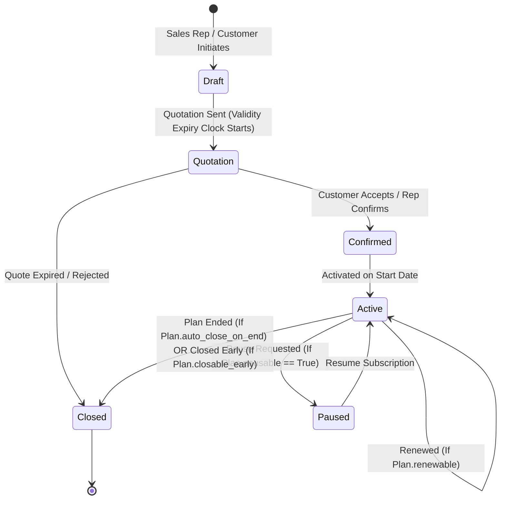
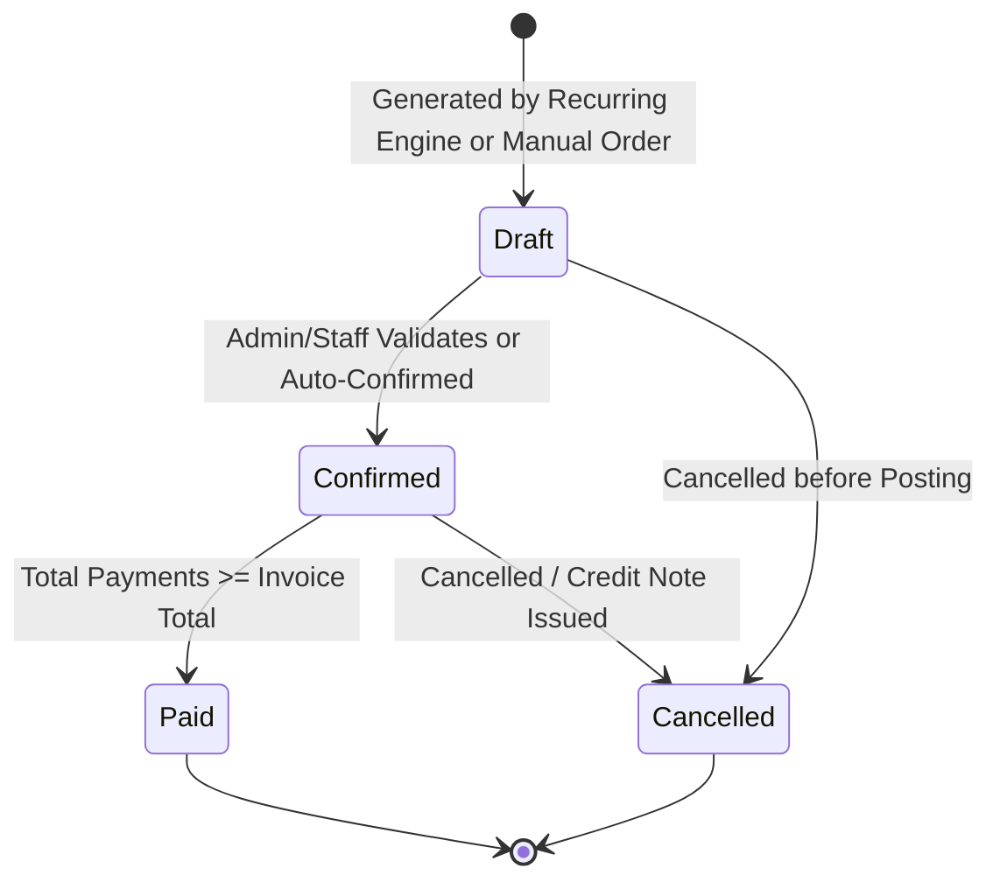

# Brightloop Software — Subscription Management System
## Comprehensive Deep Research, Domain Analysis & Architectural Blueprint

**Author:** Antigravity AI Engineering & Systems Architect  
**Project:** Unified Subscription & Recurring Billing Platform ("Brightloop Software")  
**Target Repository:** `https://github.com/nithishvenkat4/Subscription_Management_System_odoo`  
**Date:** October 31, 2026  
**Status:** Architecture Approved / In-Depth Research Specification

---

## Executive Summary & Challenge Context

Brightloop Software is a multi-tier SaaS and subscription business providing business software, add-on modules, and variant-based product offerings (e.g., enterprise branding, cloud tiers). Customers range from micro-businesses and small shops paying monthly to enterprise corporations on multi-year contracts.

### Current Pain Points ("How Things Run Today")
1. **Spreadsheet Subscriptions:** Subscriptions tracked manually in spreadsheets lead to missing lifecycle transitions, lost renewal opportunities, and zero single-source-of-truth.
2. **Ad-Hoc Renewals:** Renewals depend on human memory, causing involuntary churn and lost revenue.
3. **Manual Monthly Invoicing:** Manual typing of hundreds of invoices every billing cycle causes clerical errors, omissions, and customer billing disputes.
4. **Disorganized Bank Reconciliation:** Payments are manually matched against invoices by scrolling bank statements, leaving receivables out-of-date and overdue invoices uncollected.
5. **Slow Financial Reporting:** Finance leads spend days each quarter assembling reports, with no real-time visibility into Monthly Recurring Revenue (MRR), Annual Recurring Revenue (ARR), or aged receivables.
6. **Zero Self-Service:** Customers cannot view or manage their subscriptions and invoices without emailing internal staff.

---

## 1. Domain Modeling & State Machines

To eliminate these vulnerabilities, we design a mathematically rigorous, event-driven domain architecture based on double-entry principles, robust state machines, and idempotent billing algorithms.

```
+-----------------------------------------------------------------------------------+
|                            DOMAIN ENTITY RELATIONSHIPS                            |
+-----------------------------------------------------------------------------------+

     +--------------------+          1:N          +----------------------+
     |        User        |---------------------->|     Subscription     |
     | (Admin/Staff/Cust) |                       | (SUB-2026-0001)      |
     +--------------------+                       +----------------------+
               |                                             |
               | 1:N (Internal Staff)                        | 1:N
               v                                             v
     +--------------------+                       +----------------------+
     | Quotation Template |                       |  Subscription Line   |
     +--------------------+                       +----------------------+
               |                                             |
               | M:N                                         | M:1
               v                                             v
     +--------------------+          1:N          +----------------------+
     |  Product & Variant |<----------------------|   Product Variant    |
     +--------------------+                       +----------------------+
               ^                                             |
               |                                             |
     +--------------------+                       +----------------------+
     |   Discount Rule    |                       |      Tax Rule        |
     +--------------------+                       +----------------------+
               |                                             |
               +----------------------+----------------------+
                                      |
                                      v
                          +------------------------+
                          |   Automated Billing    |
                          |      Cron Engine       |
                          +------------------------+
                                      |
                                      v 1:N
                          +------------------------+
                          |        Invoice         |
                          |    (INV-2026-0001)     |
                          +------------------------+
                                      |
                                      v 1:N
                          +------------------------+
                          |        Payment         |
                          |    (PAY-2026-0001)     |
                          +------------------------+
```

---

### 1.1 Subscription Lifecycle State Machine

A subscription represents the recurring commercial contract between Brightloop and a customer. It implements a strict 5-stage formal lifecycle with configurable pause/resume hooks:



#### Transition Invariants & Guard Conditions:
- **`Draft -> Quotation`**: Requires at least one active product line with valid unit price and customer contact email.
- **`Quotation -> Confirmed`**: Requires acceptance before quotation template validity expiration (`valid_until >= CURRENT_DATE`).
- **`Confirmed -> Active`**: Sets initial `next_billing_date` to `start_date`, initializes billing sequence, and triggers first billing cycle.
- **`Active -> Paused`**: Permitted **only if** `Plan.pausable == true`. Suspends automated billing cron; freezes next billing cycle.
- **`Paused -> Active`**: Adjusts `next_billing_date` forward by paused duration or recalculates current cycle window.
- **`Active -> Closed`**:
  - Automatically triggered upon reaching `expiry_date` if `Plan.auto_close_on_end == true`.
  - Manually initiated if `Plan.closable_early == true`. If `closable_early == false`, cancellation before expiry is rejected.
- **`Active -> Renewed`**: Permitted **only if** `Plan.renewable == true`. Extends `expiry_date` by plan duration.

---

### 1.2 Invoice Lifecycle State Machine

Every billing cycle generates an immutable, sequentially numbered invoice (`INV-YYYY-XXXX`).



#### Invoice Overdue Computation:
An invoice is mathematically flagged as **Overdue** if:
$$\text{is\_overdue} \iff (\text{status} == \text{'confirmed'}) \land (\text{due\_date} < \text{CURRENT\_DATE}) \land (\text{amount\_paid} < \text{total\_amount})$$

Aging Buckets:
- **Current**: $\text{due\_date} \ge \text{CURRENT\_DATE}$
- **1 – 30 Days Overdue**: $1 \le (\text{CURRENT\_DATE} - \text{due\_date}) \le 30$
- **31 – 60 Days Overdue**: $31 \le (\text{CURRENT\_DATE} - \text{due\_date}) \le 60$
- **60+ Days Overdue**: $(\text{CURRENT\_DATE} - \text{due\_date}) > 60$

---

## 2. Granular Feature Specifications & Requirements Matrix

### 2.1 Customer Authentication & Role-Based Access Control (RBAC)
- **Role Hierarchy**:
  1. `admin`: Unrestricted system access. **Exclusively authorized** to:
     - Invite and create internal staff users.
     - Configure global tax rules.
     - Configure discount rules and usage ceilings.
     - Configure product base costs and plan lifecycle flags.
  2. `staff`: Internal team handling day-to-day operations:
     - Create and modify quotations and templates.
     - Manage subscriptions (transition status, adjust lines).
     - Confirm, cancel, send (email), and print/download PDF invoices.
     - Record payments and chase overdue invoices.
     - **Denied access** to adding new staff, editing tax rules, or creating discount rules.
  3. `customer`: External portal user:
     - Register account online.
     - Access strictly filtered Customer Portal.
     - Can view **only** their own subscriptions, invoices, and payment receipts.
     - Cannot see internal costs, other tenants' records, or staff management.
- **Password Strength Policy**:
  - Enforced at backend with regex:
    ```regex
    ^(?=.*[a-z])(?=.*[A-Z])(?=.*\d|.*[^A-Za-z0-9]).{9,}$
    ```
  - Requirement: Length $> 8$ characters (minimum 9 characters), at least one uppercase letter, at least one lowercase letter, and at least one special character.
- **Password Reset Flow**:
  - Cryptographically secure pseudo-random token generation (`secrets.token_urlsafe(32)`).
  - SHA-256 hashed token storage with strict 1-hour expiration timestamp.
  - Automated transactional email dispatch (SMTP integration + in-app preview).

---

### 2.2 Products, Variants, and Pricing Engine
- **Product Model**:
  - `name`: string (e.g., "BrightCore ERP", "Cloud Analytics Addon", "Dedicated Database")
  - `product_type`: Enum (`service`, `software`, `addon`, `consumable`)
  - `sales_price`: Decimal (base list price)
  - `cost_price`: Decimal (for internal margin calculation)
  - `notes`: Rich text / description
  - `is_active`: boolean
- **Variants & Surcharges**:
  - Variants allow multidimensional pricing adjustments.
  - Example: Brand attribute:
    - Standard Edition: $+\$0.00$
    - Odoo Brand Edition: $+\$560.00$
  - Dynamic Line Calculation:
    $$\text{effective\_unit\_price} = \text{product.sales\_price} + \sum \text{variant\_surcharges}$$

---

### 2.3 Recurring Plans & Plan Lifecycle Rules
Plans define the billing tempo and lifecycle behavior:
- `billing_interval`: Enum (`daily`, `weekly`, `monthly`, `yearly`)
- `recurring_rate`: Decimal base plan price
- `min_quantity`: Integer (minimum seats/units required)
- `available_from` & `available_to`: Date range validity
- **Lifecycle Control Flags** (Admin-configured per plan):
  - `auto_close_on_end`: bool — When the end date arrives, automatically transition to `Closed`.
  - `closable_early`: bool — Customer or staff can terminate before the term expires.
  - `pausable`: bool — Subscription can be paused during vacations/downtime.
  - `renewable`: bool — Can be renewed seamlessly into a subsequent cycle.

---

### 2.4 Quotation Templates & Rapid Quote-to-Subscription Workflow
- Sales reps frequently assemble standard offers for enterprise accounts.
- **Quotation Template**:
  - Template name, description.
  - Default plan assignment.
  - Pre-configured product lines (product, variant, default quantity, discounted rate).
  - `validity_days`: e.g., 14 days, 30 days.
- **Workflow**:
  - Rep clicks "New Quote from Template" $\rightarrow$ selects template $\rightarrow$ lines automatically populate.
  - Rep selects customer $\rightarrow$ system computes `valid_until = today + template.validity_days`.
  - Quote sent to customer via portal / email.
  - Customer accepts $\rightarrow$ one-click transition: `Draft -> Quotation -> Confirmed -> Active`.

---

### 2.5 Automated Recurring Billing Engine ("Billing Day")
Brightloop processes hundreds of subscription renewals simultaneously.

#### Zero-Double-Billing Guarantee (Idempotency Architecture):
To ensure no customer is billed twice or skipped:
1. **Idempotency Key**:
   $$\text{billing\_idempotency\_key} = \text{MD5}(\text{subscription\_id} + \text{current\_billing\_cycle\_date})$$
2. **Transactional Lock**:
   - The engine selects active subscriptions where `next_billing_date <= CURRENT_DATE`.
   - Before invoice generation, queries whether an invoice with the same idempotency key or `(subscription_id, cycle_start_date)` already exists.
   - If found, skips creation and logs warning.
3. **Proration & Calculation**:
   - Copies active subscription lines.
   - Applies eligible discounts.
   - Computes tax lines based on admin tax rules.
   - Generates sequential invoice `INV-YYYY-XXXX`.
4. **Advancement of Next Billing Date**:
   $$\text{next\_billing\_date}_{\text{new}} = \begin{cases} 
   \text{date} + 1\text{ day} & \text{if interval is daily} \\
   \text{date} + 7\text{ days} & \text{if interval is weekly} \\
   \text{date} + 1\text{ month (calendar adjusted)} & \text{if interval is monthly} \\
   \text{date} + 1\text{ year} & \text{if interval is yearly}
   \end{cases}$$
5. **Auto-Close Handling**:
   - If `subscription.expiry_date` is reached and `plan.auto_close_on_end` is true, the subscription is marked `Closed`.

---

### 2.6 Automatic Discount Rules Engine
Discounts must apply automatically without human manual intervention:
- **Discount Parameters**:
  - `discount_type`: `percentage` (e.g. 15%) or `fixed_amount` (e.g. $100 off).
  - `discount_value`: Decimal.
  - `min_purchase_amount`: Decimal (e.g. orders $> \$500$).
  - `min_quantity`: Integer (e.g. $> 10$ seats).
  - `start_date` and `end_date`: Date range validity.
  - `max_uses`: Maximum global usages permitted.
  - `used_count`: Real-time counter of applied cycles.
  - `scope`: `whole_subscription` vs `specific_products`.
- **Automated Application Rule**:
  - During billing execution, the engine evaluates available discounts.
  - If conditions match:
    1. Attaches discount line to generated invoice.
    2. Increments `used_count`.
    3. If `used_count >= max_uses` or `CURRENT_DATE > end_date`, automatically deactivates discount.

---

### 2.7 Payments & Accounts Receivable Management
- **Payment Attributes**:
  - Payment sequence (`PAY-YYYY-XXXX`).
  - Invoice foreign key.
  - Payment method: `Credit Card`, `Bank Transfer`, `Stripe`, `Cash`, `Cheque`.
  - Amount, Payment Date, Reference / Transaction Note.
- **Reconciliation Engine**:
  - Updates `invoice.amount_paid += payment.amount`.
  - Automatically updates invoice status:
    - If `amount_paid >= invoice.total_amount` $\rightarrow$ `Paid`.
    - If `0 < amount_paid < invoice.total_amount` $\rightarrow$ `Confirmed` (Partial).
  - Overpayment validation prevents recording excess amounts.

---

### 2.8 Finance Lead Analytics & Executive Reporting (< 2s Performance SLA)
The finance lead requires instant access to financial health metrics.

#### Core Financial Formulas:
1. **Normalized Monthly Recurring Revenue (MRR)**:
   $$\text{MRR} = \sum_{s \in \text{Active Subscriptions}} \begin{cases}
   \text{line\_total}(s) \times 30 & \text{if interval is daily} \\
   \text{line\_total}(s) \times \frac{52}{12} & \text{if interval is weekly} \\
   \text{line\_total}(s) & \text{if interval is monthly} \\
   \frac{\text{line\_total}(s)}{12} & \text{if interval is yearly}
   \end{cases}$$
2. **Annual Recurring Revenue (ARR)**:
   $$\text{ARR} = \text{MRR} \times 12$$
3. **Total Cash Collected**:
   $$\text{Cash Collected} = \sum \text{Payment.amount (within date range)}$$
4. **Outstanding Accounts Receivable**:
   $$\text{Outstanding AR} = \sum_{i \in \text{Unpaid Invoices}} (\text{total\_amount} - \text{amount\_paid})$$

#### Database Optimization Strategy for < 2s Response Time with 100,000+ Records:
- **Composite Indexes**:
  - `idx_sub_status_dates (status, next_billing_date, start_date)`
  - `idx_inv_status_due (status, due_date, customer_id)`
  - `idx_pay_date_invoice (payment_date, invoice_id)`
- **Aggregation Acceleration**:
  - Pre-aggregated SQL queries using indexed conditional sums (`SUM(CASE WHEN ...)`).
  - Server-side pagination with query limits and indexed cursors.
  - In-memory caching for dashboard summaries with fast TTL invalidation on payment/invoice events.

---

## 3. Dual-Delivery Architecture: Full Platform + Odoo Addon

To deliver maximum value and guarantee full compliance with both the assessment brief and enterprise standards, this project implements a **Dual-Delivery Architecture**:

### Deliverable A: Unified Full-Stack Platform ("Brightloop Web Platform")
- **Backend**: Python 3.13 + FastAPI + SQLAlchemy 2.0 ORM + Pydantic v2 schemas + SQLite/PostgreSQL.
- **Frontend**: Modern responsive UI with curated Odoo Purple & Slate aesthetic, responsive glassmorphism, dynamic animations, role switching (Admin, Staff, Customer), PDF invoice printing, live search/filtering, and interactive analytical charts.
- **Automated Billing Engine**: Integrated async cron engine + manual "Run Billing Day Now" simulation button for instant demonstration.
- **Test Suite**: Automated pytest test suite covering authentication, RBAC, discount rules, idempotency, billing runs, and analytics.

### Deliverable B: Native Odoo 17 / 18 Addon Module (`brightloop_subscription`)
- Located in `/brightloop_subscription` ready for plug-and-play installation in any Odoo 17/18 instance.
- **Odoo Models**:
  - `brightloop.subscription`: Full state machine, recurring lines, invoicing wizard.
  - `brightloop.subscription.plan`: Frequencies, min quantity, auto-close/pausable flags.
  - `brightloop.discount.rule`: Rules engine matching the specification.
  - `product.template` inheritance: Variant surcharges and recurring attributes.
  - `sale.order` inheritance: Quotation template to subscription converter.
- **Odoo Views & Menus**: Tree, Form, Kanban, Search views, action buttons, security group definitions (`ir.model.access.csv`, security XML).
- **Odoo Cron Job**: `ir.cron` definition for automated recurring invoice generation.

---

## 4. Implementation Milestones & Hourly Commit Plan

| Milestone | Target Time | Deliverables | Commit Message |
|---|---|---|---|
| **Hour 0** | Immediate | Deep Research, System Architecture, Git Initialization & Baseline Spec | `docs: add comprehensive deep research and system architecture blueprint` |
| **Hour 1** | +60 mins | Core Database Models, Schema Migrations, Auth & RBAC Engine, Product/Plan Catalog | `feat(core): implement database models, auth, rbac, and product catalog` |
| **Hour 2** | +120 mins | Quotation Engine, Subscription Lifecycle, Automated Billing Day Engine, Taxes & Discounts | `feat(billing): implement automated billing engine, tax/discount logic, and subscription lifecycle` |
| **Hour 3** | +180 mins | Payments & Invoices, PDF Generator, Executive Finance Dashboard, Customer Portal UI | `feat(ui): implement executive analytics dashboard, customer portal, and invoice pdf generator` |
| **Hour 4** | +240 mins | Native Odoo 17/18 Addon Module, Comprehensive Pytest Suite, Benchmarks (< 2s SLA), Final Documentation | `feat(odoo): add native odoo addon module, automated test suite, and performance benchmarks` |

---
*Blueprint verified and ready for execution.*
